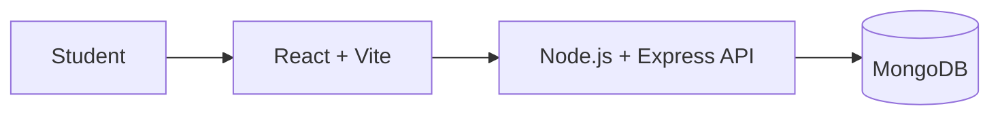

# EduCore LMS

A learning management system project for my Prodesk Sprint 13 capstone.

I'm building EduCore as a place where students can find courses, open lessons and keep track of their learning progress. For this sprint, I'm focusing on the project plan and the main screens before adding more features.

## What I want to build

- Sign in and create account screens
- Student dashboard
- Course catalog
- My courses and lesson list
- Course progress display
- Responsive layout for smaller screens

## Tech stack

- **Frontend:** React, Vite, CSS
- **Backend:** Node.js and Express (planned)
- **Database:** MongoDB (planned)
- **Authentication:** JWT (planned)

The current code is an early frontend prototype. Login is only a demo flow at this stage; real authentication, API routes and database storage still need to be built and tested.

## Main screens

1. **Login / Register** — a simple entry point for students.
2. **Dashboard** — course totals and a continue-learning section.
3. **Course details** — course information, lessons and progress.

## Plan for the first version

**First:** finish the main screens and make sure they work on desktop and mobile.

**Next:** add course search and filters, then connect the UI to an API.

**Later:** implement secure authentication, save enrollments and progress in MongoDB, and add instructor/admin features if time allows.

## Planned architecture



This shows the intended setup. The API and database are not implemented yet.

## Wireframes

I'm planning these three screens in Figma:

- Login / Register
- Student Dashboard
- Course Details

Figma link: **TODO — add the shared Figma URL after the screens are made.**

I have written a short checklist for these screens in [the wireframe notes](docs/FIGMA_WIREFRAME_SPEC.md).

## Run the frontend

Open a terminal in the `client` folder and run:

```bash
npm install
npm run dev
```

To create a production build:

```bash
npm run build
```

## Sprint 13 checklist

- [x] Choose EduCore LMS as the project
- [x] Write down the first-version features and tech stack
- [x] Add an initial architecture diagram
- [ ] Make the three Figma wireframes and add the link
- [ ] Test the frontend build
- [ ] Add exported architecture diagrams when ready
