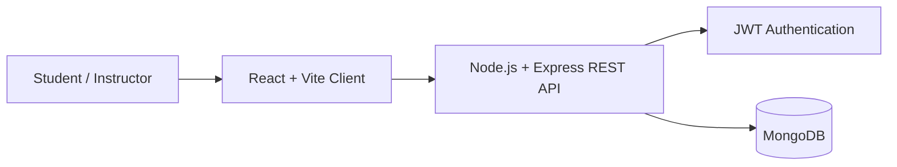
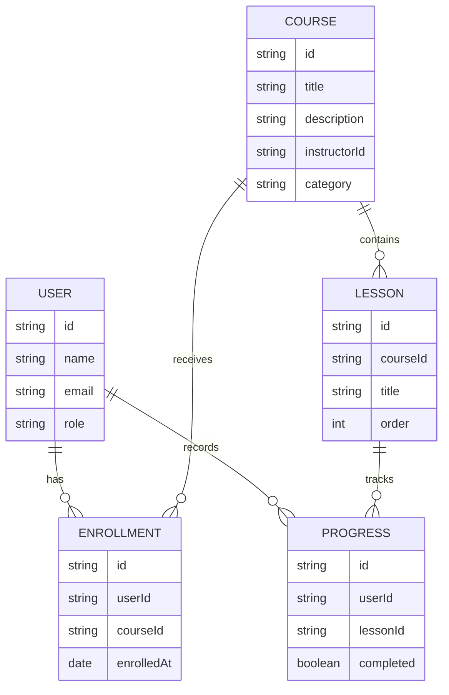

# EduCore LMS — Prodesk IT Capstone

**Project name:** EduCore LMS  
**Designated track:** Enterprise Learning Management System (LMS)  
**Sprint:** 13 — Product Planning, System Architecture & UI/UX Design  
**Project status:** Planning and frontend prototype  
**Repository:** `sprint13-prodesk-capstone-educore-lms`

## 1. Product overview

EduCore is a proposed enterprise learning platform for learners and instructors to discover courses, enroll in learning paths, access lessons, and monitor progress from one workspace. The capstone will be developed in phases, with the product requirements and system design defined before expanding implementation.

## 2. Problem statement

Learning content, enrollment information, and progress updates can be spread across different tools. EduCore aims to bring core learning activities into one consistent interface and provide a foundation that can later support instructor and administrator workflows.

## 3. Target users

- **Students/Learners:** discover courses, enroll, study lessons, and track progress.
- **Instructors:** organize course content and review learner progress (planned).
- **Administrators:** manage users and course publishing (planned).

## 4. Prioritized feature roadmap

### P0 — MVP (core scope)
1. Responsive authentication screens and role-aware navigation.
2. Student dashboard with course summary and learning progress.
3. Course catalog with course details and enrollment entry point.
4. My Courses view with lesson list and progress indicator.
5. Clear loading, empty, validation, and error states.
6. Setup instructions and documented project architecture.

### P1 — Recommended product capabilities
1. Instructor course creation and lesson management.
2. Persistent course enrollment and progress tracking.
3. Search and category filters for the course catalog.
4. Accessible, responsive layouts for desktop and mobile.
5. User profile and account settings.

### P2 — Stretch goals
1. Administrator dashboard and user management.
2. Assessments, quizzes, and completion certificates.
3. Notifications and course announcements.
4. Analytics for course completion and learner engagement.

## 5. Technology stack

| Layer | Proposed technology | Status |
|---|---|---|
| Frontend | React, Vite, CSS | Initial prototype present |
| Backend API | Node.js, Express | Planned; implementation not yet verified |
| Database | MongoDB | Planned; implementation not yet verified |
| Authentication | JWT with secure password hashing | Planned; implementation not yet verified |
| UI/UX | Figma | Wireframes to be created |
| Version control | Git and GitHub | Active |

> **Scope note:** The current repository contains a React/Vite frontend prototype. The backend, database persistence, and production authentication must not be considered complete until implemented and tested.

## 6. Core user journeys

1. **Sign in / create account:** enter account details and reach the student workspace.
2. **Discover a course:** browse the catalog, inspect course information, and start enrollment.
3. **Continue learning:** open an enrolled course, select a lesson, and review progress.
4. **Track progress:** view course summaries and progress indicators on the dashboard.

## 7. UI/UX wireframes — Sprint 13 deliverable

Create these minimum three viewports in Figma before expanding the code:

1. **Authentication:** sign-in and account creation, validation, and recovery entry point.
2. **Student dashboard:** navigation, learning summary cards, continue-learning section, and course progress.
3. **Course details / learning view:** course description, instructor, lesson list, enrollment/continue action, and progress.

**Figma file:** _TODO — add the public Figma URL here after creating and sharing the wireframes._  
Do not treat this placeholder as a completed Figma deliverable.

## 8. System architecture

### Proposed full-stack request flow



### Proposed data model (initial ERD)



These are proposed design diagrams for planning, not proof of a deployed backend or existing database collections. Export polished diagrams from a diagramming tool and embed them here for the stretch-goal submission.

### Frontend state plan

- **Authentication state:** current user, role, and session status.
- **Catalog state:** search query, selected category, and course list.
- **Learning state:** active course, lessons, and progress.
- **UI state:** loading, validation messages, empty states, and errors.

Suggested mock API contract for planning:
- `POST /api/auth/register`
- `POST /api/auth/login`
- `GET /api/courses`
- `GET /api/courses/:courseId`
- `POST /api/courses/:courseId/enroll`
- `GET /api/me/enrollments`
- `PATCH /api/progress/:lessonId`

## 9. Acceptance criteria

- [ ] README documents project name, designated track, stack, and prioritized core features.
- [ ] Three Figma wireframes are created and a public link is added above.
- [ ] User journeys and MVP scope are reviewed before major implementation.
- [ ] Architecture and data model are reviewed; exported diagram images are added for stretch goals.
- [ ] Frontend build succeeds and key screens are manually checked.
- [ ] Any unimplemented backend or authentication feature is clearly labelled as planned.

## 10. Run the frontend prototype

From the `client` directory:

```bash
npm install
npm run dev
```

To create a production build:

```bash
npm run build
```

## 11. Sprint 13 deliverable status

- [x] Public GitHub repository initialized
- [x] Product scope and prioritized roadmap documented
- [x] Proposed system architecture and data model documented
- [ ] Three Figma wireframes and public Figma link
- [ ] Exported architecture diagram images
- [ ] Frontend production build verification
